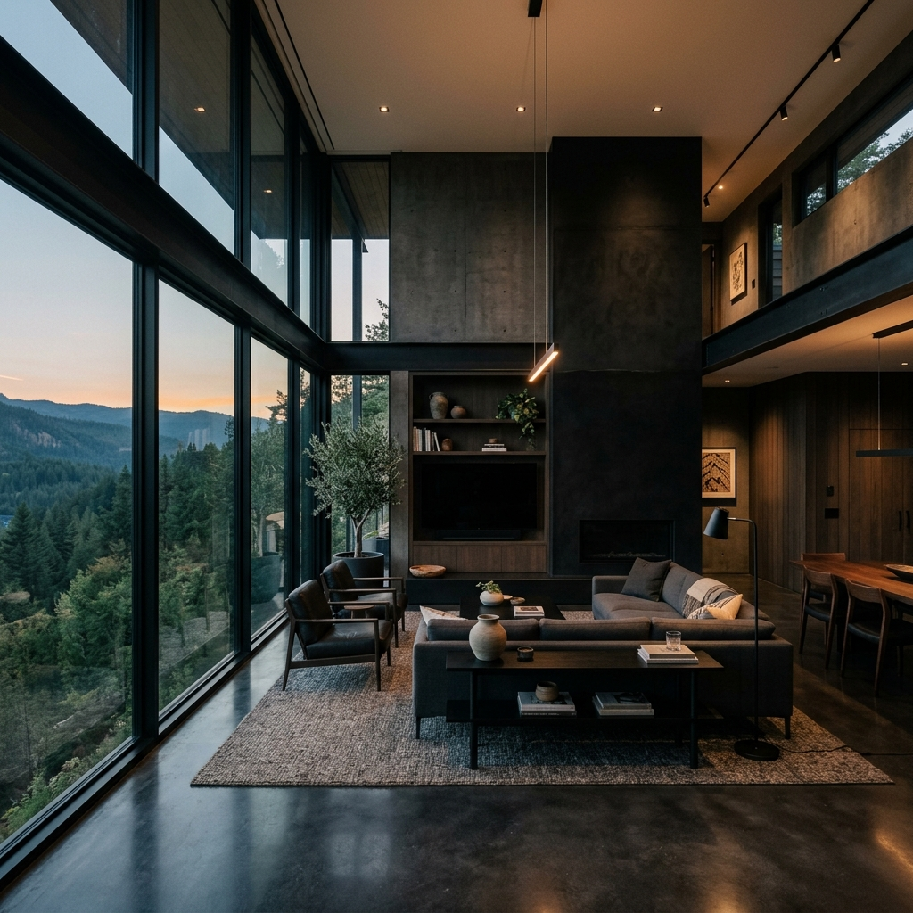

# Lamica - Interior Design Studio

[](https://lamica-interior.vercel.app)

Website studio interior design **Lamica** - elegan, gelap, dan minimalis - menampilkan hero bergaya editorial, portofolio proyek, profil atelier, dan kontak dalam satu halaman yang mengalir.

## Fitur

- **Hero full-bleed** - visual utama dengan glass panel berisi highlight layanan (Quality, Beauty) dan indikator slide.
- **Section About** - narasi studio dengan foto suasana kerja.
- **Section Portfolio** - karya proyek interior dengan foto pendukung.
- **Section Atelier** - pengenalan tim/workshop studio.
- **Section Contacts & Login** - halaman kontak dan akses login di header.
- **Navigasi anchor halus** - About, Portfolio, Atelier, Contacts dalam satu halaman.
- **Gaya visual konsisten** - tipografi serif display, panel kaca, dan aksen dekoratif SVG.

## Tech Stack

| Layer | Teknologi |
| --- | --- |
| UI Library | React 19 |
| Build Tool | Vite 8 |
| Styling | Custom CSS (`src/index.css`) |

## Menjalankan Lokal

```bash
git clone https://github.com/indraaryaLabs/lamica-interior.git
cd lamica-interior
npm install
npm run dev
```

Buka `http://localhost:5173` di browser.

Perintah lain:

```bash
npm run build # build produksi ke folder dist/
npm run preview # pratinjau hasil build
npm run lint # cek kualitas kode dengan ESLint
```

## Cuplikan




## Struktur Proyek

```
public/
├── hero.png # Visual hero
├── about.png # Foto section about
├── atelier.png # Foto section atelier
├── port1.png, port2.png # Foto portofolio
└── contact.png # Visual section kontak
src/
├── App.jsx # Seluruh section halaman (header, hero, about, portfolio, atelier, contacts)
├── index.css # Styling custom
└── main.jsx # Entry point
```

## License

Proyek ini dilisensikan di bawah [MIT License](LICENSE).
